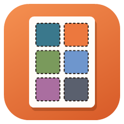

# Planche Contact



Application Windows en Rust (egui) pour préparer des planches A4 de magnets à imprimer en sublimation.

## Fonctions

- Glisser-déposer ou bouton « Ajouter des images » (PNG, JPEG, WebP, BMP, GIF, TIFF, PDF).
  Un PDF donne un design par page, rendu par le moteur PDF de Windows.
- Clic droit sur une image : nombre d'exemplaires, largeur, format, portrait / paysage, retirer.
- Touche Suppr sur l'image sélectionnée : un exemplaire de moins (retirée au dernier).
- Annuler / Rétablir (Ctrl+Z, Ctrl+Y ou Ctrl+Maj+Z).
- Formats de recadrage (Magnet 75 × 55, Mug 200 × 75, ou les tiens) : l'image est recadrée
  au format, et on la fait glisser sur la planche pour choisir la partie gardée.
  Option pour recadrer automatiquement les nouvelles images.
- Alerte sous 200 dpi (risque de flou) sur la carte et sur la planche.
- « Remplir la planche » : ajoute des exemplaires d'un design dans toute la place libre.
- « Optimiser la place » : change l'ordre et le sens (portrait / paysage) des designs
  pour utiliser moins de papier.
- Récapitulatif par format dans la barre d'état (ex. « 10 Magnet · 2 Mug · 1 page(s) »).
- Planches enregistrées sous un nom (`%APPDATA%\PlancheContact\planches`), à rouvrir en un clic.
- Alerte au changement d'imprimante pour penser à vérifier les profils ICC.
- Mise en page automatique des exemplaires à la suite, sur une ou plusieurs pages.
- Redimensionnement en gardant les proportions (champs ou poignée sur la planche).
- Si tout ne tient pas : proposer d'ajouter une page ou de réduire les images.
- Mode magnet : débord autour de chaque image (1,5 mm par défaut, 75 × 55 → imprimé 78 × 58).
- Traits de coupe carrés ou ronds, ou seulement des repères aux coins (rien sur le design) ;
  impression en miroir pour le transfert.
- Mire de test couleur (gris, couleurs pures, teintes chair, dégradés) à ajouter en un clic.
- Couleurs : profil ICC des images et de sortie (LittleCMS), intention de rendu,
  compensation du point noir, aperçu fidèle à l'écran, teinte R/V/B, luminosité, contraste.
- Export PDF (profil ICC embarqué) ou impression via la boîte d'impression Windows
  (papier, qualité, miroir du pilote…).
- Réglages et dernière planche enregistrés automatiquement dans
  `%APPDATA%\PlancheContact\reglages.json`.

## Compiler

```
cargo build --release
```

L'exe est dans `target\release\planche-contact.exe`.

### Version portable

Réglages et planches dans `PlancheContact-donnees`, à côté de l'exe :

```
cargo build --release --no-default-features --features portable --target-dir target\portable
```

Pour ne laisser aucun chemin personnel dans l'exe, définir avant (PowerShell) :

```
$env:RUSTFLAGS = "--remap-path-prefix=$env:USERPROFILE\.cargo\registry\src=deps --remap-path-prefix=$env:USERPROFILE\.rustup=rustup --remap-path-prefix=$PWD=planche-contact -Clink-arg=/PDBALTPATH:%_PDB%"
```

On peut aussi passer des images au lancement : `planche-contact.exe "image.png*4" "autre.png*2"`
(le nombre après `*` est le nombre d'exemplaires).

## Icône

`assets\icon.png` et `assets\icon.ico` sont générés par `assets\make-icon.ps1`.

## Conseil couleurs (sublimation)

Choisir le profil ICC fourni avec les encres de sublimation comme profil de sortie,
intention « Colorimétrique relatif » avec compensation du point noir (comme Photoshop),
et désactiver la correction des couleurs dans les propriétés du pilote d'imprimante.

## Licence

MIT, voir [LICENSE](LICENSE).
